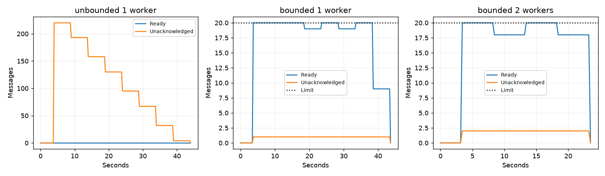
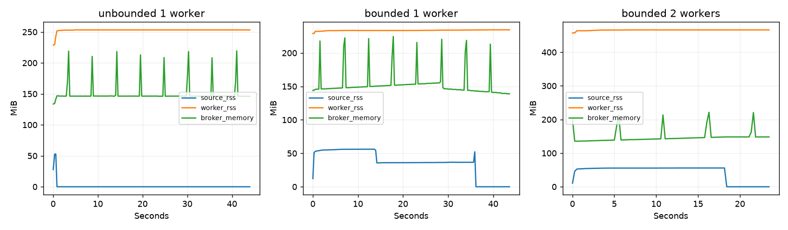
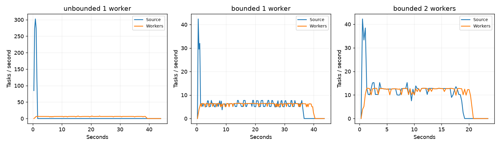
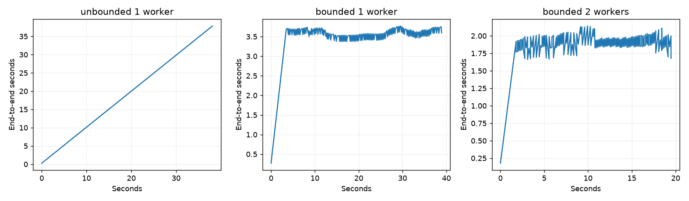

# GenUI Quality Gate

Сервис попарной оценки веб-интерфейсов, созданных языковыми моделями.

## Конвейер

```text
JSONL → пакетный источник ─┐
                         ├→ RabbitMQ → FastStream worker → PostgreSQL
POST /process ────────────┘                  ↑
                                    MLflow Model Registry
```

Источник и воркер — отдельные процессы, связанные через RabbitMQ. Воркер один раз при старте загружает модель по `GENUI_MODEL_NAME` и `GENUI_MODEL_ALIAS`. Версия и Run ID доступны в его `/healthz` и результате задачи. После смены alias нужен перезапуск воркера.

## Запуск

Нужны Python 3.13, uv и Docker Compose. Создать `.env` из `.env.example`, задать локальные пароли; существующий `.env` не перезаписывать.

```bash
make setup
make ml-up
make train
docker compose build app
docker compose up -d --wait app worker
make pipeline-data
docker compose --profile batch run --rm source
```

`make train` нужен, если в MLflow ещё нет модели с alias `champion`. API работает на порту 8000, MLflow — 5001, RabbitMQ Management — 15672. Доступ только с localhost; пользователь RabbitMQ — `genui`, пароль — `RABBITMQ_PASSWORD`.

## Ограничение нагрузки и доставка

- Очередь durable, сообщения persistent, публикация использует `mandatory` и publisher confirms. `GENUI_QUEUE_CAPACITY=20` задаёт `x-max-length`, `x-overflow=reject-publish` сообщает источнику о переполнении отрицательным подтверждением. Источник повторяет текущую запись с задержкой от 20 мс до 1 с; после успеха задержка сбрасывается. Фиксированного ограничения частоты нет.
- Источник читает JSONL по одной записи. Batch ID сохраняется до первой публикации, позиция в файле — после confirm. Checkpoint обновляется атомарно и хранится в volume `source_state`. После сбоя возможна повторная отправка с прежним ID, но не пропуск записи. Один checkpoint используется одним процессом.
- `GENUI_PREFETCH_COUNT=1` соответствует одному потоку `GENUI_WORKER_CONCURRENCY=1`. Prefetch больше числа потоков запрещён. Модель и задержка `GENUI_INFERENCE_DELAY_SECONDS` выполняются в `ThreadPoolExecutor`, не блокируя event loop.
- Лимит 20 относится к Ready. При N воркерах дополнительно допускается N Unacked; при аварийном возврате сообщений нужно учитывать этот запас. В измерениях представлены обе величины.

Publisher confirms выбраны вместо опроса Management API: проверка глубины запаздывает и не исключает гонку с публикацией. Фиксированный rate limit не адаптируется к скорости воркеров, `drop-head` теряет задачи. Management API используется только для измерений.

`POST /process` и `POST /api/v1/tasks` принимают `prompt`, `html_a`, `html_b` и возвращают `202`, `task_id` и адрес результата. `GET /api/v1/tasks/{task_id}` возвращает результат; до первой сохранённой записи — `404`. Для повторных запросов предусмотрен UUID в `Idempotency-Key`.

При перегрузке API возвращает `503` с `Retry-After`, не ожидая освобождения очереди. Лимит одновременных публикаций — 8, таймаут confirm — 250 мс. API не создаёт запись в БД, поэтому после отказа не остаётся `PENDING`. `Retry-After = max(1, ceil(inference_delay_seconds / worker_concurrency))` оценивает время освобождения слота в целых секундах. Это load shedding: внешнему клиенту отказано; внутренний источник сохраняет задачу и замедляется. При сетевом таймауте результат публикации неизвестен — повторять нужно с тем же ID.

Выбран `AckPolicy.MANUAL`: ack отправляется после commit результата. Подтверждение до обработки могло бы потерять задачу при сбое. Автоматический ack после успешного выхода тоже допустим, но ручная политика явно задаёт повтор и подтверждение доставки в DLQ. Первичный ключ `task_id`, `INSERT ... ON CONFLICT` и блокировка строки защищают от дублирования результата при одновременной повторной доставке.

Ошибки модели и валидации допускают `GENUI_MAX_ATTEMPTS=3` попытки с задержкой. Затем задача получает `FAILED`; исходное сообщение подтверждается только после подтверждённой публикации в `<queue>.dlq`. Сбой между публикацией и ack может создать повтор в DLQ с тем же ID. При недоступности БД сообщение повторяется до восстановления. Гарантия доставки — at-least-once, результат в БД идемпотентен.

При SIGTERM воркер прекращает приём и завершает активные обработчики. Таймаут завершения — 60 с, grace period контейнера — 75 с; искусственная задержка ограничена 30 с. Второй воркер добавляется без изменения кода:

```bash
docker compose up -d --no-deps --scale worker=2 worker
```

При изменении prefetch нужно согласовать число потоков. Для другого лимита очереди обработать старые задачи и задать новое `GENUI_QUEUE_NAME`: аргументы существующей очереди неизменяемы. Настройки очереди должны совпадать у всех участников.

## Эксперимент

22.10.2026: 240 записей по 38 344 байта, модель `genui-pairwise-quality`, alias `champion` (версия 2), задержка 150 мс, один поток на воркер. Docker VM: 4 CPU, 6 GiB RAM. Без ограничений отключены лимит очереди и prefetch; в остальных опытах Ready ≤ 20, prefetch = 1.

| Показатель | Без ограничений, 1 воркер | Ограничения, 1 воркер | Ограничения, 2 воркера |
| --- | ---: | ---: | ---: |
| Завершено задач | 240 | 240 | 240 |
| Максимум Ready в выборке | 0 | 20 | 20 |
| Максимум Unacked в выборке | 220 | 1 | 2 |
| Средняя скорость источника за публикацию, задач/с | 446.45 | 6.74 | 13.35 |
| Скорость источника в установившемся режиме, задач/с | — | 6.15 | 12.26 |
| Скорость обработки в том же интервале, задач/с | — | 6.15 | 12.26 |
| Время опыта до опустошения очереди, с | 43.99 | 43.60 | 23.48 |
| P50 полного времени задачи, с | 19.08 | 3.56 | 1.87 |
| P95 полного времени задачи, с | 35.92 | 3.73 | 2.05 |
| Пиковый RSS источника, MiB | 52.88 | 56.11 | 55.75 |
| Пиковый суммарный RSS воркеров, MiB | 253.41 | 234.53 | 466.49 |
| Пиковая память брокера, MiB | 219.50 | 224.59 | 221.20 |

Без ограничений очередь переместилась в Unacked: нулевой Ready не означает отсутствия перегрузки. С ограничениями скорость источника сравнялась со скоростью обработки. Второй воркер повысил её в 1.99 раза и почти вдвое снизил задержку; суммарная память выросла из-за второй копии модели. Все 240 задач завершены в каждом опыте.

Измерения сняты примерно раз в 250 мс с учётом задержки обновления Management API. Установившийся интервал — после заполнения очереди до окончания публикации. Полное время задачи включает ожидание публикации и обработки; `inference_ms` в CSV также включает ожидание executor. Результаты относятся к одному локальному прогону.









## Проверки и воспроизведение

```bash
make check
make test-containers
make experiment
uv run --locked --group ml --env-file .env python -m scripts.pipeline_verify
```

`TestRabbitBroker` проверяет обработчики; Testcontainers запускает реальные RabbitMQ и PostgreSQL для проверки переполнения, повторов, DLQ, идемпотентности и доступности health-check во время inference. Локально прошли 142 теста, покрытие с ветвлениями — 97.10%.

Проверка с моделью из MLflow: `503` за 4.61 мс с `Retry-After: 2`, отклонённого ID в БД нет; ошибочная задача отправлена в DLQ после трёх попыток. При SIGTERM активная задача сохранена, процесс завершился за 2.13 с. После SIGKILL сообщение доставлено повторно, результат остался единственным.

CSV, графики, `summary.json` и `reliability.json` сохранены в `docs/experiments`. Контейнерные тесты включены в CI; удалённый запуск возможен после push.
